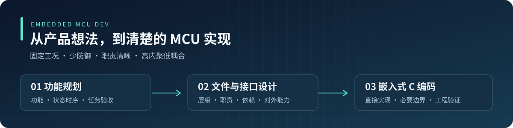

<div align="center">



# embedded-mcu-dev

**让 AI 写 MCU 固件时，更懂固定工况，也更懂工程取舍。**

功能规划 · 文件与接口设计 · 嵌入式 C 编码


[功能展示网站](https://embedded-cstyle-lab.mellowmule512.chatgpt.site/) · [快速安装](#快速安装) · [选择入口](#三个入口按需使用) · [使用示例](#从一个实际需求开始) · [安装与迁移](docs/installation.md) · [版本记录](CHANGELOG.md)

[**打开交互展示 →**](https://embedded-cstyle-lab.mellowmule512.chatgpt.site/)

浏览三个 skill 的职责、交接示例、提示词与安装指南。

</div>

---

## 为什么做这套技能

同一个固定硬件产品，串口只有一路、传感器型号已定、调用关系也清楚，AI 仍可能写出多实例上下文、回调注册、层层判空和通用适配框架。代码能运行，却让真正的功能、状态和时序更难看清。

这套技能把 MCU 开发中的三个问题分开处理：**产品要做什么、文件之间如何协作、代码如何直接实现。** 保留必要的输入校验、设备故障处理和时序约束，把复杂度花在实际工况上。

| 我们重视 | 在工程中的体现 |
| --- | --- |
| 固定工况 | 先读硬件、工具链、现有模块和调用条件，沿用已成立的约定 |
| 少防御、少架构 | 内部可信契约不反复检查；长度、CRC、设备故障等真实边界仍要处理 |
| 高内聚、低耦合 | 规则、状态和动作放在负责它们的模块，接口提供实际能力 |
| 清楚的状态与时序 | 谁发起、谁保存状态、何时完成、如何验收，都能说清楚 |

适用于固定硬件产品的 MCU 裸机与 RTOS 嵌入式 C。编码入口不适用于 C++；技能不能替代工具链检查、工程构建或上板验证。

## 三个入口，按需使用

| 你现在需要什么 | 使用哪个 skill | 交付什么 |
| --- | --- | --- |
| 需求还有缺项，需要明确功能、状态时序和验收 | [**plan · 功能与任务规划**](skills/embedded-mcu-plan/SKILL.md) `V1.0` | 功能边界、必要问题、待决项、任务依赖与验收要求 |
| 功能方向已定，需要决定代码放在哪里、模块怎样协作 | [**design · 模块与接口设计**](skills/embedded-mcu-design/SKILL.md) `V1.0.1` | 源文件、层级、职责、状态归属、依赖和必要接口 |
| 修改范围明确，需要实现、修改或评审代码 | [**code · MCU C 编码**](skills/embedded-mcu-code/SKILL.md) `V1.3` | 直接实现、适量注释、必要边界处理及相关验证 |


三者是独立入口。新功能可以逐步交接，局部修改可直接用 code。项目已有需求、设计或 OpenSpec 工件时直接复用。未确认的建议保留为待决项，不进入必须通过的验收要求。

> **仓库名与包名**：仓库叫 `embedded-mcu-dev`；插件包名保留 `embedded-mcu-development`，延续现有安装和调用名称。三个 skill 不改名。

## 快速安装

需要 Git，以及支持 `codex plugin` 的 Codex CLI。安装命令已按本机 `0.154.0` 的帮助核对；其他版本先运行 `codex plugin --help`。插件结构参考 [OpenAI 官方文档](https://developers.openai.com/plugins/build/plugins)。

**全新安装：**

```sh
codex plugin marketplace add https://github.com/tlcrgbe/embedded-mcu-dev.git
codex plugin add embedded-mcu-development@embedded-mcu-dev
codex plugin list --marketplace embedded-mcu-dev --json
```

安装后新开一个聊天，检查是否发现以下三个入口：

```text
embedded-mcu-development:embedded-mcu-plan
embedded-mcu-development:embedded-mcu-design
embedded-mcu-development:embedded-mcu-code
```

如果已装旧本机包或独立全局 skill，先阅读[迁移与去重](docs/installation.md#已有安装如何迁移)，选择一个来源；不要并排重复安装。支持插件的桌面宿主也可通过其本地插件入口使用，具体界面以当前宿主为准。

## 从一个实际需求开始

<details open>
<summary><strong>① 只有产品想法：先规划</strong></summary>

```text
使用 embedded-mcu-development:embedded-mcu-plan。
基于现有 STM32 巡线小车工程，整理启停、巡线和丢线处理需求。
固定条件和需求见附件；缺少的产品选择集中提问。
输出功能拆分、状态时序、待决项、任务依赖和验收要求，只做规划。
```

得到能交给模块设计者的输入。是否自动恢复、超时多久等未确认选择仍保持待决。

</details>

<details>
<summary><strong>② 行为已确认：设计文件和接口</strong></summary>

```text
使用 embedded-mcu-development:embedded-mcu-design。
根据已确认的小车规划和当前工程，划分源文件并分配功能。
说明每个文件的层级、职责、状态归属、直接依赖和对外能力。
底层、设备驱动、业务按实际需要组织，中间层按需设置；本次不编码。
```

得到文件与接口设计。灯和蜂鸣器的硬件能力由驱动提供，业务负责灯效、提示和运行策略；已有 HAL 能力直接复用。

</details>

<details>
<summary><strong>③ 范围已经清楚：直接编码或评审</strong></summary>

```text
使用 embedded-mcu-development:embedded-mcu-code。
按已确认接口修改串口接收解析：识别帧头、长度、数据和 CRC。
复用现有接收缓冲区与工程约定，按 cmd 调用相应业务处理。
修改范围和验收要求见任务卡，完成相关检查并说明验证结果。
```

实现仍以现有工程为准：固定实例可以使用模块静态状态；真实的长度和 CRC 边界要检查；不为假想扩展引入注册框架。

</details>

## 这套包里有什么

```text
embedded-mcu-dev/
├── .agents/plugins/marketplace.json  # 供插件市场发现
├── plugin.json                     # 包名、版本和展示信息
├── skills/
│   ├── embedded-mcu-plan/SKILL.md
│   ├── embedded-mcu-design/SKILL.md
│   └── embedded-mcu-code/
│       ├── SKILL.md
│       └── references/open-source-style.md
├── docs/                           # 安装、迁移和使用说明
├── component-versions.json          # 组件版本与内容摘要
└── CHANGELOG.md                     # 包版本记录
```

包仅包含技能与说明，没有 MCP 服务或生命周期 hook。宿主按任务读取技能，编码参考按需加载；README、版本记录和实验历史不会被塞进每个 skill 正文。

## 当前版本与验证

本仓库首次收录包版本 **`1.0.0-rc.2`**，保留已确认的 plan V1.0、design V1.0.1、code V1.2。设计措辞已按 Oracle 意见澄清，三个 skill 的具体规则此次不再扩展。

该组件组合已完成本机安装、去重后的发现检查、格式与内容摘要检查，以及根代理显式读取后的三个控制样例。新聊天自动选用和任意真实工程的效果仍需分别验证。详细边界见[使用说明](docs/usage.md#验证如何理解)。

维护时先说明实际问题，再用任务比较结果决定是否调整规则。更新记录放在 [CHANGELOG](CHANGELOG.md)，不让历史过程增加技能调用上下文。

## 常见问题

**是不是必须走完 plan → design → code？** 不需要。当前任务需要哪一步，就使用哪一步。

**“少防御”会不会省略故障处理？** 不会。它减少已知契约下的重复检查，保留外部输入、设备故障和并发时序所需的处理。

**现有工程目录不同怎么办？** 沿用工程约定，按职责识别层级，不为了套目录模板大规模搬文件。

**与原仓库是什么关系？** 本仓库接续原 `embedded-cstyle-team` 的编码工作，统一维护三个 skill。当前内容已自包含，不依赖原仓库在线；旧历史仍在原仓库中保留。

**许可证是什么？** 当前尚未选择开源许可证。公开可见不等于授予任意再分发权限；后续明确许可证后单独更新。
